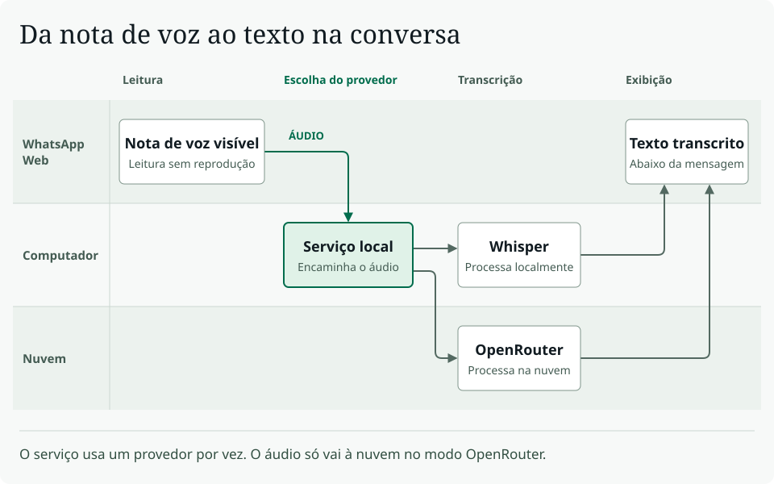

# Transcritor para WhatsApp Web

Uma extensão pessoal para ler notas de voz direto na conversa. Ela transcreve os áudios visíveis em fila, coloca o texto abaixo de cada mensagem e deixa os controles de mídia livres para a sua música. Você também pode copiar o texto ou refazer uma transcrição.

**Whisper local** processa o áudio no seu computador e funciona sem chave de API. **OpenRouter** envia o áudio ao provedor configurado e permite resumir o texto sob demanda. Você escolhe o modo no serviço local. Uma falha no Whisper nunca muda o processamento para a nuvem.

## Fluxo de transcrição



[Versão HTML com descrição em texto](docs/diagram/fluxo-de-transcricao.html)

## Instalação

1. Na [última versão no GitHub](https://github.com/guilhermelippert/whatsapp-transcriber/releases/latest), abra **Assets** e baixe **whatsapp-transcriber-setup.zip**. Ele contém a extensão e o serviço que roda no seu computador. Extraia o ZIP inteiro para uma pasta definitiva do seu usuário. A opção **Source code (zip)** também funciona. O ZIP só da extensão é para quem já tem o serviço configurado.
2. Instale o [Node.js 22 ou superior com npm](https://nodejs.org/en/download). Se escolher **Whisper local**, prepare também os três arquivos da seção abaixo. Para **OpenRouter**, basta ter uma chave de API e acesso à internet.
3. No Chrome, Helium ou outro Chromium compatível, abra `chrome://extensions`, ative **Modo do desenvolvedor**, clique em **Carregar sem compactação** e selecione a pasta `extension` extraída. Copie o **ID** de 32 letras exibido no cartão. Mantenha a pasta nesse local para conservar o ID. Em um navegador gerenciado, a instalação depende da política do administrador.
4. Inicie o serviço pelo método do seu sistema. No primeiro uso, cole o ID no assistente, escolha o provedor e siga as perguntas. Para autorizar mais de um navegador, cole os IDs separados por vírgulas.

   | Sistema | Como configurar e iniciar |
   | --- | --- |
   | macOS | Abra `Iniciar.command`. Se o arquivo perdeu a permissão de execução ao extrair ou o Finder bloquear a abertura, use a opção pelo terminal abaixo, conforme as permissões do seu Mac. |
   | Windows | Abra `Iniciar.cmd`. Se a política do computador restringir scripts, use um terminal autorizado na pasta extraída. |
   | Linux | Abra o terminal na pasta extraída e execute `node scripts/setup.mjs --start`. |

   Em qualquer sistema, você pode abrir um terminal na pasta que contém `package.json` e usar `node scripts/setup.mjs --start`. Para configurar e iniciar em etapas separadas, execute `npm run setup` e depois `npm start`. O serviço usa apenas módulos do Node.js e dispensa `npm install`.

5. **Mantenha a janela do serviço aberta** enquanto usa a extensão. Abra o popup, confira o provedor e recarregue a aba do WhatsApp Web. Para parar, pressione **Ctrl+C**. Nas próximas vezes, use o mesmo iniciador. O assistente preserva o `.env.local` existente. Para mudar de provedor, ID ou chave, edite esse arquivo na pasta extraída e reinicie o serviço.

### Preparar o Whisper local

O assistente pede o executável `ffmpeg`, o executável `whisper-cli` e um modelo GGML multilíngue do whisper.cpp. Ele sugere executáveis disponíveis no `PATH` e aceita caminhos com espaços. Se eles estiverem em outra pasta, informe o caminho completo.

- **macOS com Homebrew**. Execute `brew install ffmpeg whisper.cpp`.
- **Linux (Debian/Ubuntu)**. Instale as ferramentas com `sudo apt install ffmpeg cmake build-essential`. Extraia o [código do whisper.cpp](https://github.com/ggml-org/whisper.cpp). Na pasta dele, execute `cmake -B build` e depois `cmake --build build --config Release --target whisper-cli`. O executável fica normalmente em `build/bin/whisper-cli`.
- **Windows**. Extraia uma [distribuição de FFmpeg para Windows](https://ffmpeg.org/download.html) e localize `bin\ffmpeg.exe`. Para o whisper.cpp, use um `whisper-cli.exe` compatível com sua máquina junto das DLLs fornecidas. Para compilá-lo, instale CMake e Visual Studio Build Tools com C++, extraia o [código do whisper.cpp](https://github.com/ggml-org/whisper.cpp) e execute os dois comandos CMake acima no terminal de desenvolvedor. Com o gerador do Visual Studio, procure `build\bin\Release\whisper-cli.exe`.

Para português, baixe o [modelo base multilíngue, 148 MB](https://huggingface.co/ggerganov/whisper.cpp/resolve/5359861c739e955e79d9a303bcbc70fb988958b1/ggml-base.bin). Crie a pasta `models` ao lado de `package.json` e salve o arquivo como `models/ggml-base.bin` para que o assistente o sugira. Você também pode informar outro modelo GGML local. Modelos com sufixo `.en` são específicos para inglês.

Para conferir o download do modelo base, compare o SHA-256 com `60ed5bc3dd14eea856493d334349b405782ddcaf0028d4b5df4088345fba2efe`. Execute o comando na pasta do projeto.

| macOS | Linux | Windows (PowerShell) |
| --- | --- | --- |
| `shasum -a 256 models/ggml-base.bin` | `sha256sum models/ggml-base.bin` | `Get-FileHash models/ggml-base.bin -Algorithm SHA256` |

Com o Node.js, os executáveis, suas bibliotecas e o modelo já instalados, a **transcrição local** funciona offline. O WhatsApp Web ainda precisa obter as mensagens e suas mídias.

### Usar OpenRouter

Escolha `openrouter` no assistente e cole a chave quando aparecer **entrada oculta**. Ela fica no arquivo `.env.local` da sua conta. No macOS e no Linux, o assistente cria o arquivo com acesso apenas para seu usuário. No Windows, ele herda as permissões da pasta. Extraia o ZIP em uma pasta privada do seu perfil. No popup, escolha o modelo e clique em **Autorizar envio ao OpenRouter**. A autorização vale para esse navegador e pode ser revogada no mesmo local. Com o envio autorizado, abrir uma conversa envia automaticamente os áudios visíveis elegíveis. **Resumir** envia o texto ao OpenRouter e pode gerar uma cobrança adicional. Para trocar o modelo de resumo, defina `SUMMARY_MODEL` em `.env.local` e reinicie o serviço.

## O que fica salvo

Consulte os detalhes sobre processamento local, envio à nuvem e exclusão de dados na [política de privacidade](PRIVACY.md).

O histórico recente de transcrições e resumos fica no armazenamento local da extensão, no perfil do navegador. O serviço escuta em `127.0.0.1:43110`. O modo local usa arquivos temporários durante o processamento e os remove ao terminar. Ele aceita uma transcrição por vez, com limite de 24 MiB por arquivo e 15 minutos por gravação. Mantenha o arquivo `.env.local`, os modelos e o perfil do navegador fora de qualquer pacote que compartilhar.

A extensão tenta obter a mídia da própria mensagem. Quando a versão do WhatsApp Web não disponibiliza o áudio para leitura silenciosa, o painel informa a falha e permite tentar novamente. A integração com o WhatsApp Web é independente e pode precisar de ajustes após atualizações do site.

## Desenvolvimento

```sh
npm test
npm run check
npm run fixture
```

No macOS, com o Whisper configurado e a voz Luciana instalada, `TEST_LOCAL_WHISPER=1 npm test` também verifica uma transcrição real de fala sintética em português. A suíte de navegador usa o Helium instalado no Mac ou o executável Chromium indicado por `HELIUM_BINARY`.

Com a fixture em execução, abra [a conversa simulada](http://127.0.0.1:43111/tests/fixture.html) ou [o teste de leitura da mídia](http://127.0.0.1:43111/tests/bridge-fixture.html).

O código é distribuído sob a [licença MIT](LICENSE). Para relatar uma vulnerabilidade, consulte a [política de segurança](SECURITY.md).
